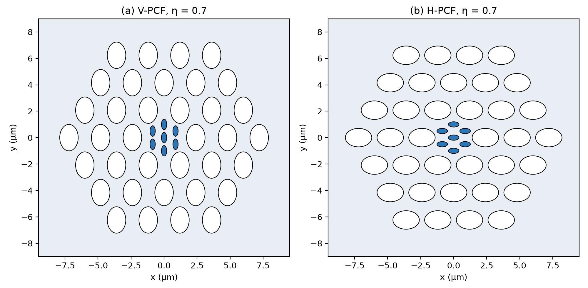
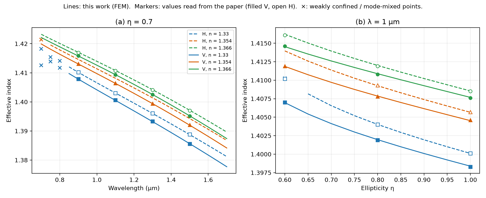
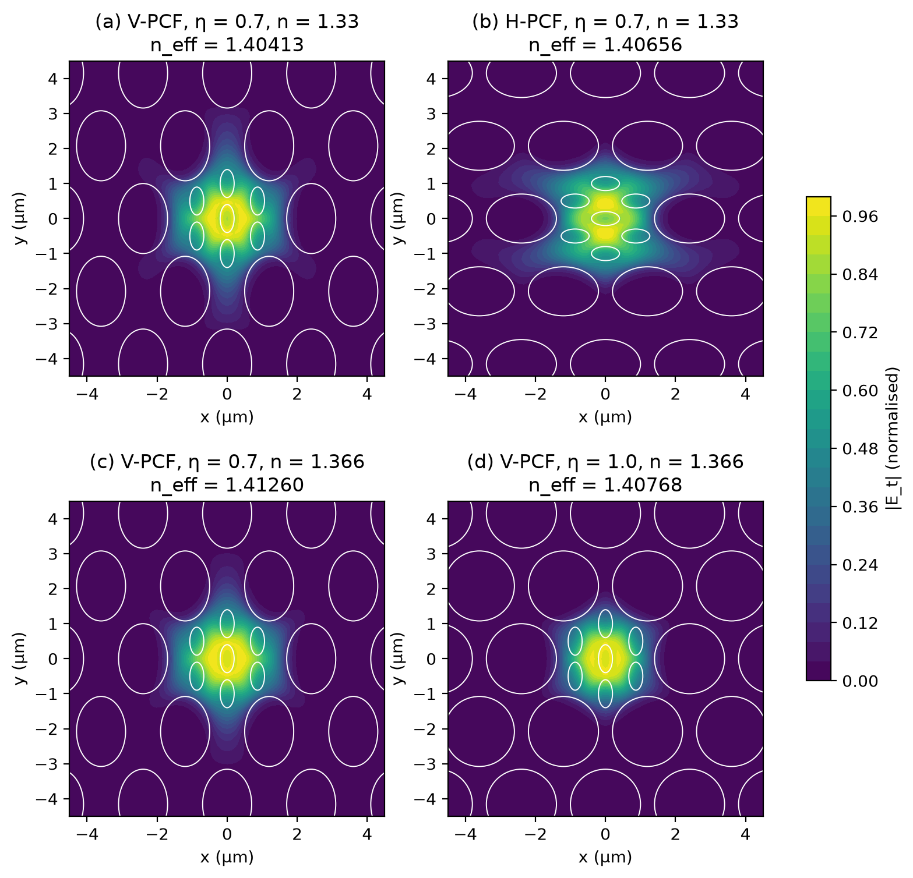
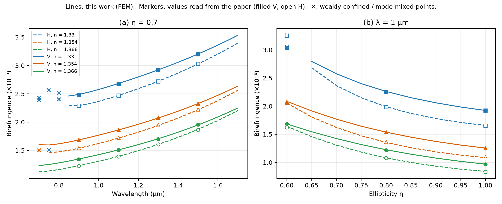
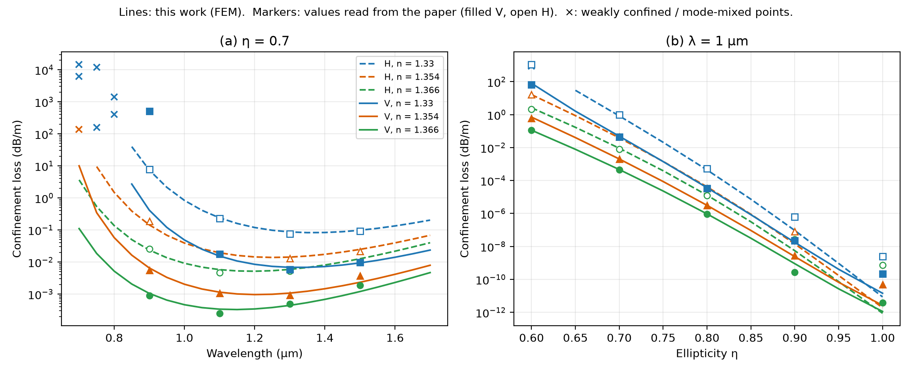
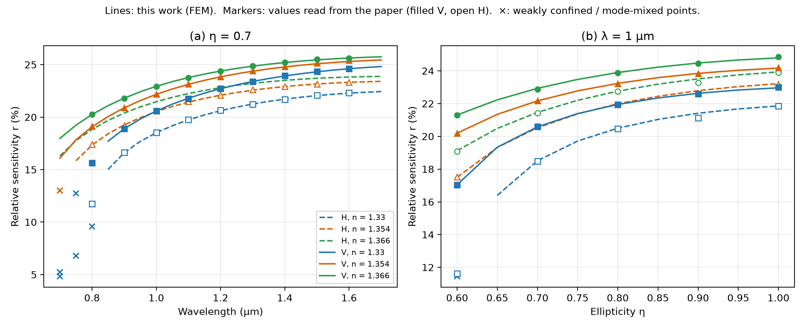
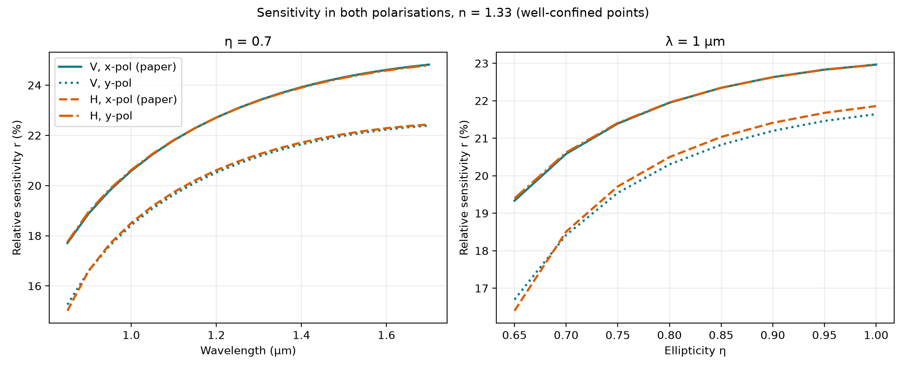
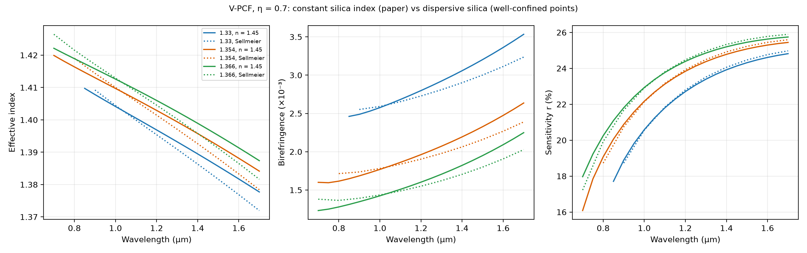

# Abstract

This project reproduces the results of Ademgil and Haxha, *Sensors* 2015, 15, 31833–31842 [1]. Two photonic crystal fibres (PCFs) with elliptical holes, V-PCF and H-PCF, carry a liquid analyte in seven small core holes. A full-vector finite element (FEM) mode solver with perfectly matched layers (PML) was written in Python and checked against an exact analytical solution. All result figures of the paper (Figs. 2–6) were recomputed, and Figs. 2, 4, 5 and 6 were compared with 206 values read from the published plots. At well-confined points the mean difference is 0.004–0.005 % for effective index, 0.21–0.37 % for birefringence and 0.11–0.24 % for relative sensitivity. Confinement loss differs by a median of about 14–16 % (mean 20–40 %, because of outliers that are discussed). The paper's finding that V-PCF has higher sensitivity and lower loss is reproduced for the x-polarised mode it uses, but is shown to depend on that choice: with each fibre in its better polarisation the sensitivities are nearly equal. The work also shows that the paper's "axis lengths" must be semi-axes, that its losses at η = 1 lie at the numerical round-off level, and how dispersive silica changes the results.

# 1. Introduction

An index-guiding PCF confines light in a silica core surrounded by air holes. If small holes in the core are filled with a liquid, part of the guided power travels inside the liquid, which makes the fibre a sensor. A good design needs high power in the liquid (sensitivity), high birefringence (to hold polarisation) and low confinement loss. The paper [1] uses elliptical holes to obtain all three together.

**Objectives**

1. Reproduce Figs. 1–6 of the paper for V-PCF and H-PCF.
2. Measure the agreement numerically rather than by visual impression.
3. Test the trends the paper claims.
4. Extend the work with the wavelength-dependent index of silica.

# 2. Structure and parameters

| Parameter | Value |
|---|---|
| Cladding holes | 36 (three hexagonal rings), air, n = 1 |
| Cladding pitch Λ~cladding~ | 2.4 µm |
| Cladding hole d~a~ (major), d~b~ = η d~a~ | 1 µm, 0.7 µm (η = 0.7); η swept 0.6–1.0 |
| Core holes | 7 (one centre, six around it), filled with analyte |
| Core pitch Λ~core~ | 1 µm |
| Core hole d~s~ (major), d~c~ (minor) | 0.4 µm, 0.2 µm |
| Silica index | 1.45 (constant) |
| Analyte index | 1.33, 1.354, 1.366 |
| Wavelength | 0.7–1.7 µm (η sweep at 1 µm) |

In V-PCF all major axes are vertical; in H-PCF all are horizontal. The core hexagon has two holes on the vertical axis in both fibres (Fig. 1).

{width=6.2in}

## 2.1 The dimensions are semi-axes

The paper calls d~a~ and d~b~ the "lengths of the major and minor axes". Its own Fig. 3 contradicts this: measured in pixels, the V-PCF holes are about 70 × 100 on a pitch of about 120, that is 1.4 µm × 2.0 µm. This matches d~a~ = 1 µm and d~b~ = 0.7 µm only if they are **semi-axes**. Four readings were simulated (V-PCF, n = 1.33, λ = 1 µm, η = 0.7):

| Reading of the stated dimensions | n~eff~ | B (×10^-3^) | Loss (dB/m) | r (%) |
|---|---|---|---|---|
| all semi-axes | 1.4041 | 2.58 | 0.0486 | 20.59 |
| all full axes | 1.4368 | 0.44 | 1.95×10^3^ | 2.15 |
| cladding semi, core full | 1.4265 | 0.64 | 1.02×10^-6^ | 5.83 |
| cladding full, core semi | 1.4219 | 0.84 | 2.72×10^4^ | 4.72 |
| **Paper (read from plots)** | 1.404 (2a, interpolated) | 2.58 (4a, interpolated) | 0.044 (5b) | 20.59 (6a) |

Only the semi-axis reading reproduces the paper, so it is used throughout, for cladding and core holes.

## 2.2 Analyte indices

The text gives 1.333 for water but every plot legend says 1.33. With 1.33 the sensitivity at 1 µm is 20.59 % and the birefringence 2.58×10^-3^; with 1.333 they are 20.79 % and 2.47×10^-3^. The paper's plots show 20.59 % and about 2.58×10^-3^ there, so 1.33 was used. The paper writes "benzyne" for n = 1.366; this report refers to that analyte only by its index.

# 3. Theory and method

The mode problem is the vector wave equation with anisotropic PML (Eq. 1 of [1]):

$$\nabla\times\left([s]^{-1}\nabla\times \mathbf{E}\right)-k_0^2n^2[s]\mathbf{E}=0,\qquad k_0=2\pi/\lambda$$

Relative sensitivity and power fraction (Eqs. 2 and 3 of [1]):

$$r=\frac{n_r}{\mathrm{Re}(n_{eff})}\,f$$

$$f=\frac{\int_{sample}\mathrm{Re}(E_xH_y^*-E_yH_x^*)\,dx\,dy}{\int_{total}\mathrm{Re}(E_xH_y^*-E_yH_x^*)\,dx\,dy}\times100$$

Birefringence and confinement loss are not written out in the paper; the standard definitions are used:

$$B=\left|n_{eff}^x-n_{eff}^y\right|,\qquad L\,[\mathrm{dB/m}]=8.686\,\frac{2\pi}{\lambda}\left|\mathrm{Im}(n_{eff})\right|$$

**Solver.** Second-order Nédélec (edge) elements represent the transverse field and quadratic Lagrange elements represent E~z~, on curved triangles so that the ellipses are followed accurately. Both mirror planes are used, so one quarter is solved: PEC at x = 0 and PMC at y = 0 for the x-polarised mode, and the reverse for y. The PML is 2.5 µm thick with a quadratic profile and starts 1 µm beyond the outermost hole. The generalised eigenproblem is solved by shift-invert Arnoldi. The LP~01~ mode is taken as the mode with the largest power fraction in the core region. Loss and sensitivity are for the x-polarised mode. Software: Python 3.12, scikit-fem [3], Gmsh [4], SciPy. COMSOL was not available; a guide and script for repeating the model in COMSOL accompany this report but had not been run.

**Very small losses.** A loss of 10^-8^ dB/m at 1 µm means Im(n~eff~) ≈ 2×10^-16^, the round-off limit of double precision. The loss is therefore computed from an energy identity instead of the eigenvalue. For $A\mathbf{x}=\mu B\mathbf{x}$ with complex-symmetric matrices that are real outside the PML,

$$\mathrm{Im}(\mu)=\frac{\mathbf{x}^H\,\mathrm{Im}(A)\,\mathbf{x}-\mathrm{Re}(\mu)\,\mathbf{x}^H\,\mathrm{Im}(B)\,\mathbf{x}}{\mathbf{x}^H\,\mathrm{Re}(B)\,\mathbf{x}}$$

Only PML entries enter the numerator, so no large terms cancel.

# 4. Validation of the solver

**Exact solution.** A circular rod of radius 1 µm at λ = 1 µm, compared with the exact HE~11~ root (largest error of the two polarisations):

| Rod / host index | Exact n~eff~ | Error, coarse (h=2) | Error, used (h=1) | Error, fine (h=0.7) |
|---|---|---|---|---|
| 1.45 / 1.4 | 1.42596051 | 3.87×10^-7^ | 2.67×10^-8^ | 6.13×10^-9^ |
| 1.45 / 1.0 | 1.40834404 | 8.19×10^-6^ | 5.74×10^-7^ | 1.47×10^-7^ |

**Mesh and PML convergence** (h = 1 is used for all results; smaller h is finer):

| Case (λ = 1 µm, x-pol) | Setting | n~eff~ | B (×10^-3^) | Loss (dB/m) | r (%) |
|---|---|---|---|---|---|
| V 0.7 1.33 | h=1.5 | 1.404173 | 2.5548 | 4.70×10^-2^ | 20.559 |
| V 0.7 1.33 | h=1 | 1.404134 | 2.5762 | 4.86×10^-2^ | 20.585 |
| V 0.7 1.33 | h=0.75 | 1.404129 | 2.5792 | 4.89×10^-2^ | 20.589 |
| V 0.7 1.33 | PML 4um | 1.404134 | 2.5762 | 4.86×10^-2^ | 20.585 |
| V 0.7 1.33 | PML s=10 | 1.404134 | 2.5762 | 4.86×10^-2^ | 20.585 |
| V 0.7 1.33 | gap 2um | 1.404134 | 2.5762 | 4.86×10^-2^ | 20.585 |
| H 0.7 1.33 | h=1.5 | 1.406573 | 2.3508 | 7.92×10^-1^ | 18.504 |
| H 0.7 1.33 | h=1 | 1.406556 | 2.3664 | 8.35×10^-1^ | 18.510 |
| H 0.7 1.33 | h=0.75 | 1.406554 | 2.3690 | 8.41×10^-1^ | 18.511 |
| H 0.7 1.33 | PML 4um | 1.406556 | 2.3664 | 8.35×10^-1^ | 18.510 |
| H 0.7 1.33 | PML s=10 | 1.406556 | 2.3664 | 8.35×10^-1^ | 18.510 |
| H 0.7 1.33 | gap 2um | 1.406556 | 2.3664 | 8.35×10^-1^ | 18.510 |
| V 1.0 1.366 | h=1.5 | 1.407703 | 0.9596 | 1.16×10^-12^ | 24.766 |
| V 1.0 1.366 | h=1 | 1.407678 | 0.9700 | 1.12×10^-12^ | 24.795 |
| V 1.0 1.366 | h=0.75 | 1.407675 | 0.9710 | 1.12×10^-12^ | 24.799 |
| V 1.0 1.366 | PML 4um | 1.407678 | 0.9700 | 1.12×10^-12^ | 24.795 |
| V 1.0 1.366 | PML s=10 | 1.407678 | 0.9700 | 1.12×10^-12^ | 24.795 |
| V 1.0 1.366 | gap 2um | 1.407678 | 0.9700 | 1.12×10^-12^ | 24.795 |

Changing PML thickness, PML strength or the silica gap changes no result by more than about 0.1 %, including a loss of 10^-12^ dB/m. Refining the mesh from h = 1 changes n~eff~ by at most about 5×10^-6^, birefringence by about 0.1 %, loss by less than 1 % and r by 0.005 percentage points.

# 5. Results

Lines are this work; markers are values digitised from the paper by pixel calibration of each plot. Markers hidden behind others were left out, not guessed. Crosses (×) are points where at most 85 % of the mode power is in the core region (r < 2 µm), so the mode is weakly confined or mixed with a cladding mode; lines are drawn only through the other points.

## 5.1 Effective index

{width=6.4in}

## 5.2 Field profiles

{width=5.2in}

As in the paper, the V-PCF field is star-shaped and compact, the H-PCF field spreads horizontally through the silica channels, and the field is most compact for η = 1.

## 5.3 Birefringence

{width=6.4in}

Birefringence is of order 10^-3^ for both fibres, as claimed.

## 5.4 Confinement loss

{width=6.4in}

## 5.5 Relative sensitivity

{width=6.4in}

## 5.6 Values at λ = 1 µm, η = 0.7

| Fibre | Analyte n | n~eff~ | B (×10^-3^) | Loss (dB/m) | r (%) |
|---|---|---|---|---|---|
| V-PCF | 1.33 | 1.40413 | 2.576 | 0.0486 | 20.59 |
| V-PCF | 1.354 | 1.40971 | 1.769 | 0.0020 | 22.17 |
| V-PCF | 1.366 | 1.41260 | 1.424 | 4.63×10^-4^ | 22.93 |
| H-PCF | 1.33 | 1.40656 | 2.366 | 0.8353 | 18.51 |
| H-PCF | 1.354 | 1.41137 | 1.621 | 0.0390 | 20.52 |
| H-PCF | 1.366 | 1.41394 | 1.307 | 0.0091 | 21.47 |

## 5.7 Values at λ = 1.5 µm, η = 0.7

| Fibre | Analyte n | n~eff~ | B (×10^-3^) | Loss (dB/m) | r (%) |
|---|---|---|---|---|---|
| V-PCF | 1.33 | 1.38564 | 3.203 | 0.0093 | 24.32 |
| V-PCF | 1.354 | 1.39200 | 2.327 | 0.0023 | 25.08 |
| V-PCF | 1.366 | 1.39521 | 1.950 | 0.0012 | 25.45 |
| H-PCF | 1.33 | 1.38876 | 3.027 | 0.0977 | 22.05 |
| H-PCF | 1.354 | 1.39428 | 2.219 | 0.0247 | 23.16 |
| H-PCF | 1.366 | 1.39713 | 1.872 | 0.0126 | 23.70 |

# 6. Comparison with the paper

| Figure | All points | Mean error (%) | Max error (%) | Well-confined points | Mean error (%) | Max error (%) |
|---|---|---|---|---|---|---|
| 2a: n~eff~ vs λ | 20 | 0.005 | 0.009 | 20 | 0.005 | 0.009 |
| 2b: n~eff~ vs η | 17 | 0.004 | 0.008 | 16 | 0.004 | 0.008 |
| 4a: Birefringence vs λ | 24 | 0.208 | 0.674 | 24 | 0.208 | 0.674 |
| 4b: Birefringence vs η | 18 | 0.361 | 1.326 | 16 | 0.371 | 1.326 |
| 6a: Sensitivity vs λ | 45 | 0.979 | 38.719 | 43 | 0.111 | 0.402 |
| 6b: Sensitivity vs η | 30 | 0.282 | 1.463 | 29 | 0.241 | 1.386 |

The first error columns use every digitised point; the last two use only well-confined points. The 85 % limit that defines "well-confined" was chosen after the results were seen, so both sets are given; the all-point figures are the stricter test.

**Confinement loss** spans 15 decades and is read from a logarithmic axis where one pixel is about 6.5 % (Fig. 5a) or 12 % (Fig. 5b). The median difference is 14.4 % for Fig. 5a (23 points) and 16.5 % for Fig. 5b (29 points), or 11.1 % for the 19 points of Fig. 5b where the paper's loss is above 10^-7^ dB/m. The mean differences are larger, 19.8 % and 40.4 %, because of outliers. Individual points differ by much more; all are listed in the appendices and discussed in Section 7.

## 6.1 Check of each claim

| Claim in the paper | Holds at | Exceptions (λ in µm, or η) |
|---|---|---|
| n~eff~ of H above V, wavelength sweep | 63/63 | none |
| n~eff~ of H above V, η sweep | 27/27 | none |
| n~eff~ falls with λ | 119/120 | V-PCF, n = 1.33, at 0.75 |
| n~eff~ falls with η | 48/48 | none |
| n~eff~ rises with analyte index | 60/60 | none |
| B of V above H, wavelength sweep | 62/63 | 0.7 (n = 1.33) |
| B of V above H, η sweep | 26/27 | 0.6 (n = 1.33) |
| B rises with λ | 114/120 | H-PCF, n = 1.33, at 0.75; H-PCF, n = 1.33, at 0.85; H-PCF, n = 1.354, at 0.75; V-PCF, n = 1.33, at 0.8; V-PCF, n = 1.33, at 0.85; V-PCF, n = 1.354, at 0.75 |
| B falls with η | 48/48 | none |
| Loss of V below H, wavelength sweep | 62/63 | 0.8 (n = 1.33) |
| Loss of V below H, η sweep | 24/27 | 1.0 (n = 1.33); 1.0 (n = 1.354); 1.0 (n = 1.366) |
| Loss falls with η | 48/48 | none |
| Loss falls with analyte index | 60/60 | none |
| r of V above H, wavelength sweep | 61/63 | 0.7 (n = 1.33); 0.8 (n = 1.33) |
| r of V above H, η sweep | 27/27 | none |
| r rises with λ | 119/120 | V-PCF, n = 1.33, at 0.8 |
| r rises with η (highest at η = 1) | 48/48 | none |

All comparisons use the x-polarised mode (see Section 7.6). Counts for "V against H" and "analyte index" are over points; counts for "rises/falls with λ or η" are over steps between neighbouring points, and the exception is named by the end of the step. All points are counted, including weakly confined ones. Most exceptions are at λ ≤ 0.85 µm, where the n = 1.33 mode is weakly confined or mixed; the paper's own birefringence curves for n = 1.33 and 1.354 also turn upwards at short wavelength. The η = 0.6 exception for B also appears in the paper's Fig. 4b, although its text says V is higher.

# 7. Discussion of differences

**7.1 Mode mixing (V-PCF, n = 1.33, λ ≈ 0.8 µm).** The paper gives r = 15.62 %; this work gives 9.57 % exactly at 0.80 µm. A scan in 0.01 µm steps shows why: a cladding mode crosses the core mode there (n~eff~ 1.41168 and 1.41180) and the two share their power. Just beside the crossing r is 14.48 % (0.79 µm) and 15.89 % (0.81 µm), either side of the paper's value. A single wavelength inside such a crossing is not representative.

**7.2 V-PCF, n = 1.33 at 0.9 µm.** The paper plots a loss of 513 dB/m; this work gives 0.413 dB/m, 0.418 with a finer mesh, and the same with a thicker PML. The mode has 97 % of its power in the core and its r and n~eff~ agree with the paper. The paper is not consistent with itself on this curve: at λ = 1 µm, η = 0.7 its Fig. 5a reads about 0.14 dB/m and its Fig. 5b reads 0.044 dB/m for the same point. This work gives 0.0486 dB/m, close to Fig. 5b. The cause of the 513 dB/m value could not be determined.

**7.3 Losses at η = 1.** The paper's values there are 3 to about 825 times larger than ours. Reading the loss directly from the complex eigenvalue, and repeating with slightly different solver shifts, gives values that scatter between zero and about 2×10^-8^ dB/m, while the energy identity is stable:

| Fibre, n (η = 1) | Energy identity (dB/m), 3 shifts | Direct eigenvalue (dB/m), 3 shifts |
|---|---|---|
| V, 1.33 | 1.43×10^-11^, 1.43×10^-11^, 1.43×10^-11^ | 1.39×10^-9^, 4.13×10^-9^, 4.08×10^-9^ |
| V, 1.354 | 2.63×10^-12^, 2.63×10^-12^, 2.63×10^-12^ | 5.44×10^-12^, 0, 0 |
| V, 1.366 | 1.12×10^-12^, 1.12×10^-12^, 1.12×10^-12^ | 1.15×10^-12^, 2.71×10^-12^, 2.71×10^-11^ |
| H, 1.33 | 8.64×10^-12^, 8.64×10^-12^, 8.64×10^-12^ | 2.70×10^-9^, 1.38×10^-9^, 3.49×10^-10^ |
| H, 1.354 | 1.90×10^-12^, 1.90×10^-12^, 1.90×10^-12^ | 1.16×10^-8^, 4.16×10^-9^, 2.42×10^-9^ |
| H, 1.366 | 8.72×10^-13^, 8.72×10^-13^, 8.72×10^-13^ | 1.57×10^-8^, 1.01×10^-8^, 1.33×10^-9^ |

The paper's values at η = 1 (4×10^-12^ to 2×10^-9^ dB/m) are within the range of this scatter, so they are probably affected by round-off. One consequence is that the paper's ordering "V below H" is not found at η = 1, where H is slightly lower here. Such losses are far below any practical relevance.

**7.4 H-PCF losses at η = 0.9** are 5 to 7 times lower here than in the paper. The largest (9.3×10^-8^ dB/m) is above the round-off level and changes by only 0.2 % with a finer mesh. This difference is unexplained.

**7.5 Other remarks on the paper.** The H-PCF, n = 1.366 curve is not visible in Fig. 6a although it is present in Fig. 6b; our r for it at 1 µm is 21.47 %. The V-PCF loss markers at 1.5 µm for n = 1.354 and 1.366 are 1.6 times our values, which are mesh-converged; this is also unexplained.

**7.6 The V against H comparison depends on polarisation.** The numbers in the paper match our x-polarised mode for both fibres. V-PCF and H-PCF are nearly the same structure turned by 90°, so this compares the better polarisation of V with the worse one of H. At every well-confined point, r is larger in x for V and in y for H. Compared x with x, V is higher at all 85 points; compared y with y, H is higher at all of them. With each fibre in its better polarisation, r differs by at most 0.12 percentage points and neither fibre is ahead consistently (V ahead at 42 of 85 points). The lower of the two losses is smaller in V at 32 of 85 points, with a ratio H/V between 0.78 and 6.96. Birefringence does not depend on this choice and is higher in V at all these points.

| λ (µm) | n | r: V x-pol | r: H x-pol | r: V best | r: H best | Loss: V best | Loss: H best |
|---|---|---|---|---|---|---|---|
| 1.0 | 1.33 | 20.59 | 18.51 | 20.59 | 20.62 | 0.0486 | 0.0665 |
| 1.5 | 1.33 | 24.32 | 22.05 | 24.32 | 24.29 | 0.0093 | 0.0073 |
| 1.0 | 1.354 | 22.17 | 20.52 | 22.17 | 22.19 | 0.0020 | 0.0022 |
| 1.5 | 1.354 | 25.08 | 23.16 | 25.08 | 25.06 | 0.0023 | 0.0019 |
| 1.0 | 1.366 | 22.93 | 21.47 | 22.93 | 22.96 | 4.63×10^-4^ | 4.88×10^-4^ |
| 1.5 | 1.366 | 25.45 | 23.70 | 25.45 | 25.44 | 0.0012 | 9.59×10^-4^ |

{width=6.2in}

# 8. Extension: dispersive silica

The paper holds the silica index at 1.45. Real fused silica follows the Sellmeier equation (Malitson [2]), which equals 1.45 near 1.03 µm. V-PCF, η = 0.7:

{width=6.5in}

| λ (µm) | n | n~eff~ (1.45 → Sellmeier) | B (×10^-3^) | Loss (dB/m) | r (%) |
|---|---|---|---|---|---|
| 0.9 | 1.33 | 1.4078 → 1.4092 | 2.49 → 2.55 | 0.4132 → 0.5765 | 18.89 → 18.73 |
| 0.9 | 1.366 | 1.4158 → 1.4171 | 1.35 → 1.39 | 0.0010 → 0.0013 | 21.81 → 21.67 |
| 1.0 | 1.33 | 1.4041 → 1.4045 | 2.58 → 2.59 | 0.0486 → 0.0513 | 20.59 → 20.56 |
| 1.0 | 1.366 | 1.4126 → 1.4129 | 1.42 → 1.44 | 4.63×10^-4^ → 4.84×10^-4^ | 22.93 → 22.91 |
| 1.3 | 1.33 | 1.3932 → 1.3909 | 2.92 → 2.81 | 0.0068 → 0.0057 | 23.40 → 23.52 |
| 1.3 | 1.366 | 1.4025 → 1.4002 | 1.71 → 1.62 | 4.42×10^-4^ → 3.77×10^-4^ | 24.86 → 24.97 |
| 1.5 | 1.33 | 1.3856 → 1.3817 | 3.20 → 3.00 | 0.0093 → 0.0077 | 24.32 → 24.47 |
| 1.5 | 1.366 | 1.3952 → 1.3912 | 1.95 → 1.80 | 0.0012 → 0.0010 | 25.45 → 25.60 |
| 1.7 | 1.33 | 1.3777 → 1.3720 | 3.53 → 3.24 | 0.0235 → 0.0202 | 24.82 → 24.98 |
| 1.7 | 1.366 | 1.3874 → 1.3816 | 2.25 → 2.03 | 0.0047 → 0.0041 | 25.75 → 25.90 |

Sensitivity changes by less than 0.2 percentage points in the table, so the paper's sensitivity conclusions survive. In V-PCF, birefringence falls by 8–10 % at 1.7 µm; loss falls by 12–18 % for λ ≥ 1.2 µm and rises by 27–40 % at 0.9 µm. The analyte indices were kept constant.

# 9. Conclusions

1. The paper's effective index, birefringence and sensitivity were reproduced to well under 1 % on average at well-confined points.
2. The paper's ranking is reproduced for the x-polarised mode: at η = 0.7 and wavelengths of 0.85 µm and above, V-PCF has higher sensitivity, higher birefringence and lower loss than H-PCF for all three analytes. Only the birefringence advantage is independent of polarisation; with each fibre in its better polarisation the sensitivities are nearly equal (Section 7.6).
3. The best sensitivity among the points computed is 25.75 % (V-PCF, n = 1.366, λ = 1.7 µm, η = 0.7). At λ = 1 µm the best is 24.80 %, at η = 1.
4. The stated dimensions are semi-axes; the paper's wording is misleading on this point.
5. Losses below about 10^-8^ dB/m need a method that avoids round-off, and modes at short wavelength must be checked for mixing.

**Limitations.** Silica and liquids are lossless; the holes are ideal ellipses; the paper's data were read from plots; all results are simulations and were not cross-checked in COMSOL.

# References

[1] H. Ademgil and S. Haxha, "PCF Based Sensor with High Sensitivity, High Birefringence and Low Confinement Losses for Liquid Analyte Sensing Applications," *Sensors*, vol. 15, pp. 31833–31842, 2015. doi:10.3390/s151229891

[2] I. H. Malitson, "Interspecimen Comparison of the Refractive Index of Fused Silica," *J. Opt. Soc. Am.*, vol. 55, p. 1205, 1965. doi:10.1364/JOSA.55.001205

[3] T. Gustafsson and G. D. McBain, "scikit-fem: A Python package for finite element assembly," *J. Open Source Softw.*, vol. 5, no. 52, 2369, 2020. doi:10.21105/joss.02369

[4] C. Geuzaine and J.-F. Remacle, "Gmsh: A 3-D finite element mesh generator with built-in pre- and post-processing facilities," *Int. J. Numer. Meth. Eng.*, vol. 79, pp. 1309–1331, 2009. doi:10.1002/nme.2579

# Appendix A. Confinement loss, Fig. 5a (η = 0.7; x = wavelength in µm)

| x | Fibre, n | Paper (dB/m) | This work (dB/m) | Ratio (this work / paper) |
|---|---|---|---|---|
| 0.9 | H, 1.33 | 7.69×10^0^ | 7.38×10^0^ | 0.96 |
| 1.1 | H, 1.33 | 2.31×10^-1^ | 2.39×10^-1^ | 1 |
| 1.3 | H, 1.33 | 7.63×10^-2^ | 8.67×10^-2^ | 1.1 |
| 1.5 | H, 1.33 | 9.22×10^-2^ | 9.77×10^-2^ | 1.1 |
| 0.9 | H, 1.354 | 1.85×10^-1^ | 1.44×10^-1^ | 0.78 |
| 1.3 | H, 1.354 | 1.30×10^-2^ | 1.42×10^-2^ | 1.1 |
| 1.5 | H, 1.354 | 2.16×10^-2^ | 2.47×10^-2^ | 1.1 |
| 0.9 | H, 1.366 | 2.53×10^-2^ | 2.36×10^-2^ | 0.93 |
| 1.1 | H, 1.366 | 4.59×10^-3^ | 5.77×10^-3^ | 1.3 |
| 1.3 | H, 1.366 | 5.20×10^-3^ | 5.86×10^-3^ | 1.1 |
| 1.5 | H, 1.366 | 9.80×10^-3^ | 1.26×10^-2^ | 1.3 |
| 0.9 | V, 1.33 | 5.13×10^2^ | 4.13×10^-1^ | 0.00081 |
| 1.1 | V, 1.33 | 1.78×10^-2^ | 1.53×10^-2^ | 0.86 |
| 1.3 | V, 1.33 | 5.90×10^-3^ | 6.81×10^-3^ | 1.2 |
| 1.5 | V, 1.33 | 9.80×10^-3^ | 9.33×10^-3^ | 0.95 |
| 0.9 | V, 1.354 | 5.55×10^-3^ | 6.50×10^-3^ | 1.2 |
| 1.1 | V, 1.354 | 1.07×10^-3^ | 1.14×10^-3^ | 1.1 |
| 1.3 | V, 1.354 | 9.16×10^-4^ | 1.07×10^-3^ | 1.2 |
| 1.5 | V, 1.354 | 3.68×10^-3^ | 2.32×10^-3^ | 0.63 |
| 0.9 | V, 1.366 | 8.88×10^-4^ | 1.04×10^-3^ | 1.2 |
| 1.1 | V, 1.366 | 2.51×10^-4^ | 3.37×10^-4^ | 1.3 |
| 1.3 | V, 1.366 | 4.87×10^-4^ | 4.42×10^-4^ | 0.91 |
| 1.5 | V, 1.366 | 1.89×10^-3^ | 1.19×10^-3^ | 0.63 |

# Appendix B. Confinement loss, Fig. 5b (λ = 1 µm; x = η)

| x | Fibre, n | Paper (dB/m) | This work (dB/m) | Ratio (this work / paper) |
|---|---|---|---|---|
| 0.6 | H, 1.33 | 1.12×10^3^ | 8.68×10^2^ | 0.78 |
| 0.7 | H, 1.33 | 1.00×10^0^ | 8.35×10^-1^ | 0.84 |
| 0.8 | H, 1.33 | 5.18×10^-4^ | 4.38×10^-4^ | 0.85 |
| 0.9 | H, 1.33 | 6.10×10^-7^ | 9.27×10^-8^ | 0.15 |
| 1.0 | H, 1.33 | 2.40×10^-9^ | 8.65×10^-12^ | 0.0036 |
| 0.6 | H, 1.354 | 1.64×10^1^ | 1.63×10^1^ | 0.99 |
| 0.7 | H, 1.354 | 4.39×10^-2^ | 3.90×10^-2^ | 0.89 |
| 0.8 | H, 1.354 | 3.30×10^-5^ | 4.13×10^-5^ | 1.3 |
| 0.9 | H, 1.354 | 8.00×10^-8^ | 1.42×10^-8^ | 0.18 |
| 0.6 | H, 1.366 | 2.15×10^0^ | 2.60×10^0^ | 1.2 |
| 0.7 | H, 1.366 | 8.03×10^-3^ | 9.10×10^-3^ | 1.1 |
| 0.8 | H, 1.366 | 1.25×10^-5^ | 1.28×10^-5^ | 1 |
| 0.9 | H, 1.366 | 2.70×10^-8^ | 5.47×10^-9^ | 0.2 |
| 1.0 | H, 1.366 | 7.20×10^-10^ | 8.73×10^-13^ | 0.0012 |
| 0.6 | V, 1.33 | 6.45×10^1^ | 7.95×10^1^ | 1.2 |
| 0.7 | V, 1.33 | 4.39×10^-2^ | 4.86×10^-2^ | 1.1 |
| 0.8 | V, 1.33 | 3.30×10^-5^ | 3.66×10^-5^ | 1.1 |
| 0.9 | V, 1.33 | 2.20×10^-8^ | 1.75×10^-8^ | 0.8 |
| 1.0 | V, 1.33 | 2.20×10^-10^ | 1.43×10^-11^ | 0.065 |
| 0.6 | V, 1.354 | 6.11×10^-1^ | 7.04×10^-1^ | 1.2 |
| 0.7 | V, 1.354 | 2.04×10^-3^ | 2.02×10^-3^ | 0.99 |
| 0.8 | V, 1.354 | 3.16×10^-6^ | 3.10×10^-6^ | 0.98 |
| 0.9 | V, 1.354 | 2.80×10^-9^ | 2.39×10^-9^ | 0.86 |
| 1.0 | V, 1.354 | 4.90×10^-11^ | 2.63×10^-12^ | 0.054 |
| 0.6 | V, 1.366 | 1.12×10^-1^ | 1.13×10^-1^ | 1 |
| 0.7 | V, 1.366 | 4.39×10^-4^ | 4.63×10^-4^ | 1.1 |
| 0.8 | V, 1.366 | 8.96×10^-7^ | 9.38×10^-7^ | 1 |
| 0.9 | V, 1.366 | 2.70×10^-10^ | 8.91×10^-10^ | 3.3 |
| 1.0 | V, 1.366 | 3.70×10^-12^ | 1.12×10^-12^ | 0.3 |
